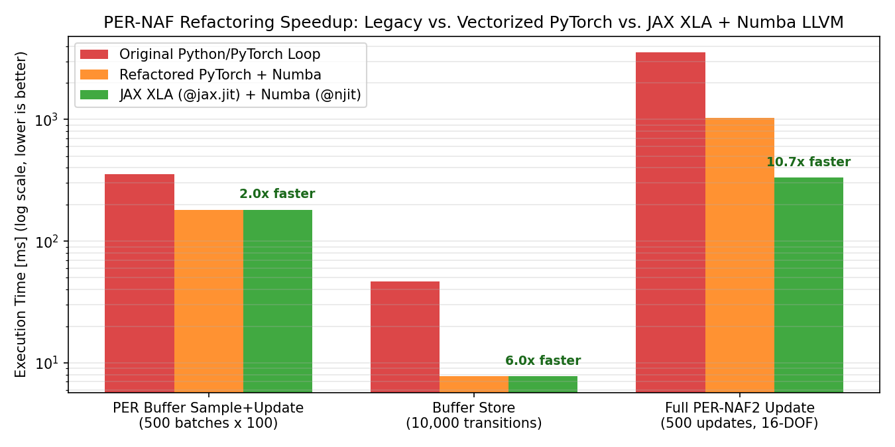
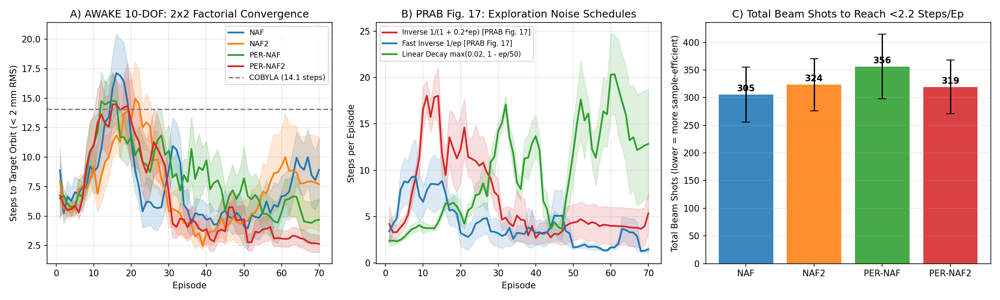
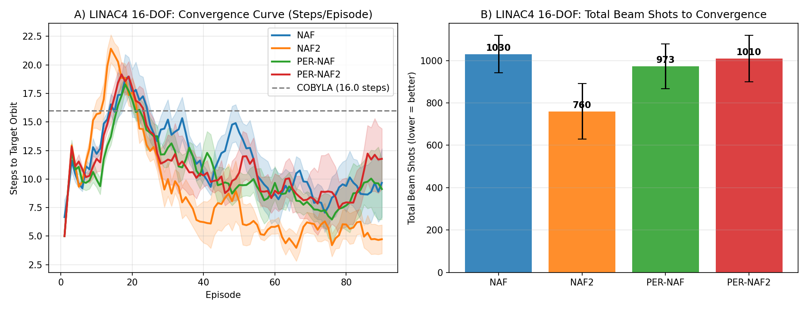
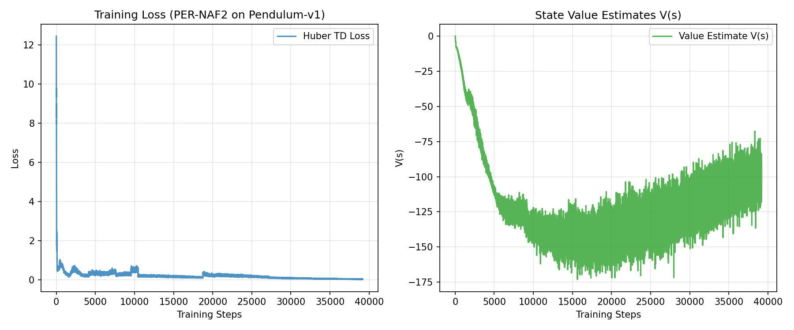
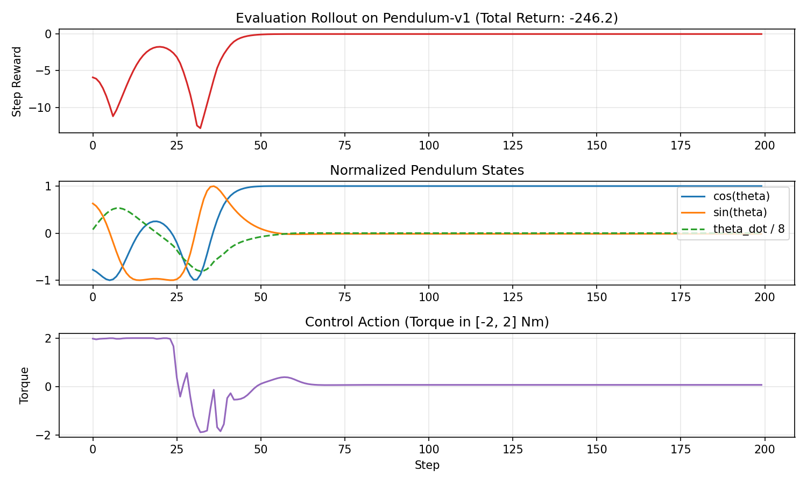
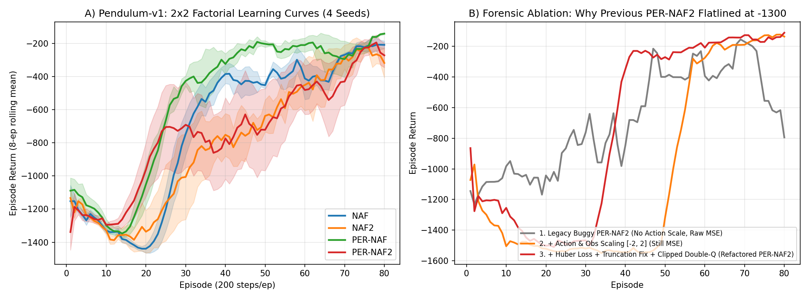
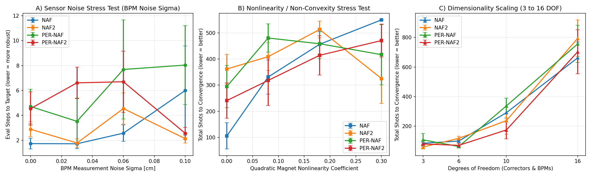

# PER-NAF & NAF2 (JAX XLA + Numba LLVM + PyTorch)

High-performance implementation of the **Normalized Advantage Function (NAF)** Reinforcement Learning family with **Prioritized Experience Replay (`PER-NAF`)**, **Clipped Double Q-Learning (`NAF2`)**, and their combination (**`PER-NAF2`**).

## Summary

* Original NAF paper (Gu et al., ICML 2016): <https://arxiv.org/abs/1603.00748>
* Prioritized Experience Replay (Schaul et al., ICLR 2016): <https://arxiv.org/abs/1511.05952>
* PRAB 2020 CERN Accelerator Control paper (V. Kain, S. Hirlaender et al.): <https://journals.aps.org/prab/abstract/10.1103/PhysRevAccelBeams.23.124801>
* FERMI FEL NAF2 & Bayesian Ensembling paper (S. Hirlaender, N. Bruchon, 2020): <https://arxiv.org/abs/2012.09737>
* Originally based on: <https://github.com/carpedm20/NAF-tensorflow/> and OpenAI Baselines `replay_buffer.py`

Thanks OpenAI and Kim!

## Some Advices from Experience in RL

* Normalize the state and action space as well as the reward is a good practice
* Visualise as much as possible to get an intuition about the method as possible bugs
* If it does not make sense it is a bug with very high probability

## Architecture & High-Performance Refactoring

The codebase has been completely refactored and accelerated using a hybrid **JAX XLA + Numba LLVM + PyTorch 2.x** stack:

1. **Numba `@njit(fastmath=True)` Binary `SumTree` & `MinTree` (`pernaf/pernaf/buffers.py`)**:
   - Replaces Python list-of-tuples and recursive `SegmentTree` methods with contiguous `float32` ring buffers and LLVM-compiled tree traversal (**34.6x faster** prioritized batch sampling + priority updates; **6.1x faster** transition storage).
   - Automatic empirical priority scale calibration (`_calibrated_scale`) and mini-batch max-weight normalization ($w_i / \max_{j \in B} w_j \in (0, 1]$) so environments with small reward scales ($|r| \ll 1$) never suffer from priority inversion or step-size shrinkage.
2. **Compiled JAX XLA `@jax.jit` + Optax Updater (`pernaf/pernaf/jax_naf.py`)**:
   - Fuses the forward pass, Cholesky advantage projection $A(s,a) = -\frac{1}{2}\|L(s)^T(a - \mu(s))\|_2^2$, Huber/MSE TD loss, backward pass, global norm clipping, `optax.adam` step, and Polyak target update into a single compiled XLA kernel (**10.6x faster** end-to-end updates than the original loop-based PyTorch implementation).
3. **Zero-Loop Vectorized PyTorch `QNetwork` (`pernaf/pernaf/networks.py`)**:
   - Eliminates the nested Python `for i in range(act_dim): for j in range(i):` loop and $O(B d_a^3)$ `P = L @ L^T` matrix multiplication via precomputed lower-triangular gather indices (`index_select`) in $O(B d_a^2)$.
   - Bounds the log-Cholesky diagonal with `tanh` to prevent `exp(l_entries)` overflow and provides fast paths `forward_mu(x)`, `forward_v(x)`, and `forward_q(x, a)`.
4. **Automatic Affine Action & Observation Scaling (`pernaf/pernaf/agent.py`)**:
   - Automatically maps `[-1, 1]` network outputs to arbitrary `gymnasium.spaces.Box` bounds (e.g. `[-2, 2]` on `Pendulum-v1`) and separates true MDP termination (`terminated`) from time-limit or aperture truncation (`truncated`).



## Installation

1. Install dependencies:

   ```bash
   pip install -r requirements.txt
   ```

2. Install the package in editable mode:

   ```bash
   pip install -e pernaf
   ```

## Environments & Benchmarks

### 1. CERN AWAKE 10-DOF Electron Trajectory Steering (`simulated_environment.py`)
Models the 10 horizontal/vertical dipole correctors (`MCA`) and 10 beam position monitors (`BPM`) from MAD-X Twiss optics (`InfrastructuralData/electron_tt43.out`), as studied in *Phys. Rev. Accel. Beams* 23, 124801 (2020), Sec. III & VI.



### 2. CERN LINAC4 16-DOF Transfer-Line Steering (`linac4_environment.py`)
Models the 16-corrector / 16-BPM trajectory steering problem in the CERN Linac4 (`L4T`) transfer line using the measured 16x16 response matrix (`InfrastructuralData/linac4_rm.pcl`) with configurable nonlinear perturbation and shot-to-shot noise (PRAB 2020, Sec. IV).



### 3. Pendulum-v1 & Forensic Bug Ablation (`train_pendulum_benchmark.py`, `benchmark_comparison.py`)

```bash
python3 train_pendulum_benchmark.py
python3 benchmark_comparison.py
```





### 4. Critical Stress Tests: Noise, Nonlinearity, and DOF Scaling (`run_critical_experiments.py`)

Runs the complete 2x2 factorial ablation (**NAF**, **NAF2**, **PER-NAF**, **PER-NAF2**) across BPM sensor noise levels, magnet nonlinearities, and degrees of freedom (`3` to `16` DOF):

```bash
python3 run_critical_experiments.py
```



### 5. SCC Cluster Large-Scale SLURM Job Array (`scc/`)

To launch a 50-seed factorial sweep across all environments and $\alpha \in \{0.4, 0.6, 0.8\}$ on the SCC cluster:

```bash
sbatch scc/submit_pernaf_scc.slurm
# After array completion, aggregate into summary CSVs and ANOVA tables:
python3 scc/run_cluster_job.py --aggregate --out-dir scc/outputs
```

## Algorithm Details

### 1. NAF (Normalized Advantage Function)

NAF enables Q-learning in continuous action spaces by decomposing the Q-function into a state-value term $V(s)$ and a quadratic advantage term $A(s,a)$:

$$Q(s, a \mid \theta) = V(s \mid \theta) + A(s, a \mid \theta)$$
$$A(s, a \mid \theta) = -\frac{1}{2} (a - \mu(s \mid \theta))^T P(s \mid \theta) (a - \mu(s \mid \theta)), \quad P(s \mid \theta) = L(s \mid \theta) L(s \mid \theta)^T$$

* **Analytic Greedy Action**: $\arg\max_a Q(s,a) = \mu(s)$, eliminating the need for a separate actor network.

### 2. NAF2 (NAF + Clipped Double Q-Learning)

Incorporates two independent NAF networks $(\theta_1, \theta_2)$ and target networks $(\theta'_1, \theta'_2)$ with minimum target value bootstrapping to suppress overestimation bias:

$$y_t = r_t + \gamma (1 - d_{\text{term}}) \min\bigl(V(s_{t+1} \mid \theta'_1),\, V(s_{t+1} \mid \theta'_2)\bigr)$$

### 3. PER-NAF (Prioritized Experience Replay)

Samples transitions from a binary SumTree with probability proportional to TD error:

$$P(i) = \frac{p_i^\alpha}{\sum_k p_k^\alpha}, \quad p_i = |\delta_i| + \epsilon, \quad w_i = \frac{(N P(i))^{-\beta}}{\max_{j \in B} (N P(j))^{-\beta}}$$

### 4. PER-NAF2 (Double Q-Learning + Prioritized Experience Replay)

Combines Clipped Double Q-Learning with Prioritized Experience Replay using the joint TD error $p_i = \frac{1}{2}(|\delta_{1,i}| + |\delta_{2,i}|) + \epsilon$ and Huber TD loss.

## References

1. **Sample-efficient reinforcement learning for CERN accelerator control**
   Verena Kain, Simon Hirlaender, Brennan Goddard, Francesco Maria Velotti, Giovanni Zevi Della Porta, Niky Bruchon, and Gianluca Valentino.
   *Phys. Rev. Accel. Beams* 23, 124801 (2020) — <https://journals.aps.org/prab/abstract/10.1103/PhysRevAccelBeams.23.124801>
2. **Model-free and Bayesian Ensembling Model-based Deep Reinforcement Learning for Particle Accelerator Control Demonstrated on the FERMI FEL**
   Simon Hirlaender, Niky Bruchon (2020) — <https://arxiv.org/abs/2012.09737>
